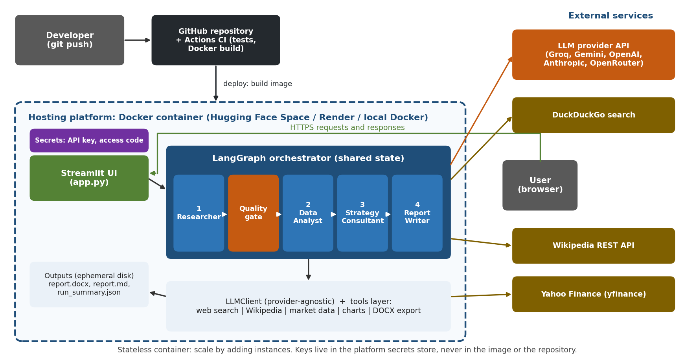

# Automated Market and Competitor Research Team

A **multi-agent AI system** that takes a company or an industry and produces a structured, consulting-style brief with market overview, competitor benchmarking, SWOT, Porter's Five Forces and prioritised recommendations. Output is a Word report (`.docx`), Markdown, and a JSON audit trail.

Built with **LangGraph** (orchestration), a provider-agnostic LLM layer (OpenAI, Anthropic, Groq, Gemini, OpenRouter, Ollama), **yfinance** and **DuckDuckGo** search as tools, and a **Streamlit** interface.


**Deployment architecture**



---

## 1. Problem statement

Strategy and consulting teams spend hours on first-pass market research: finding sources, pulling competitor financials, structuring a SWOT, and writing it up. This work is repetitive, but quality matters: figures must be traceable and conclusions must be defensible.

**Goal:** given a target (company or industry), automatically produce a first-draft brief in minutes where **every claim is traceable to a source** and **every number comes from data, not from the model's memory**.

Why multi-agent? The task has distinct skills (retrieval, quantitative analysis, strategic reasoning, writing) with different tools and failure modes. Separating them lets each agent have a narrow prompt, its own tools and its own validation, and lets the orchestrator retry or stop when evidence is weak.

## 2. The agents

| # | Agent | Responsibility | Tools |
|---|---|---|---|
| 1 | **Researcher** | Plans search queries, gathers sources, extracts source-grounded findings | DuckDuckGo search (`ddgs`), Wikipedia API |
| - | **Orchestrator quality gate** | Checks evidence sufficiency; retries with broader queries or aborts | Rules (no LLM) |
| 2 | **Data Analyst** | Pulls market data, computes margins/returns/volatility/drawdown, draws charts, writes grounded insights | `yfinance`, matplotlib |
| 3 | **Strategy Consultant** | Produces SWOT, Porter's Five Forces and 4-5 prioritised recommendations | LLM |
| 4 | **Report Writer** | Assembles the brief (LLM prose plus deterministic tables), validates citations, exports DOCX/MD | python-docx |

### Anti-hallucination guardrails

- Findings without a valid source id are **dropped**.
- Citation numbers that do not exist in the source list are **removed** from the final report.
- Analyst insights quoting numbers **not present in the data table are removed**.
- Strategy output is schema-validated; incomplete output triggers one **repair retry**, then an explicit limitation note.
- If the LLM is unavailable or its quota is exhausted, verbatim search snippets are retained as cited findings and a limited report is still generated; strategic conclusions are explicitly marked unassessed.
- Reports generated in mock mode carry a visible **DEMO MODE** banner.

## 3. Project structure

```
market-research-agents/
├── app.py                      Streamlit web UI
├── main.py                     Command-line interface
├── requirements.txt
├── .env.example                Copy to .env and add your key
├── Dockerfile, docker-compose.yml, render.yaml, .dockerignore
├── .github/workflows/ci.yml    Runs the test suite on every push
├── .streamlit/config.toml
├── src/marketresearch/
│   ├── config.py               Settings from environment variables
│   ├── state.py                Pydantic models + LangGraph state
│   ├── llm.py                  Provider-agnostic LLM client, retries, JSON repair, token tracking
│   ├── mock_llm.py             Offline stub for tests and demos
│   ├── prompts.py              All prompts in one file
│   ├── orchestrator.py         LangGraph workflow and quality gate
│   ├── agents/                 researcher.py, analyst.py, strategist.py, writer.py, base.py
│   ├── tools/                  web_search.py, wikipedia_tool.py, financials.py, charts.py
│   └── report/exporter.py      Markdown to DOCX converter
├── tests/                      31 unit and pipeline tests (run offline)
├── evaluation/                 Test cases, metrics, single-agent baseline, run_eval.py
├── docs/                       architecture and deployment diagrams (.png), Project_Report.docx
├── outputs/                    Generated reports (one folder per run)
├── Deployment_Steps.docx       What you must do manually: deploy, capture proof, record demo, finish report
└── README.md
```

## 4. Quick start

**Requirements:** Python 3.10+ (3.11 recommended).

```bash
cd market-research-agents
python -m venv .venv
source .venv/bin/activate            # Windows: .venv\Scripts\activate
pip install -r requirements.txt
cp .env.example .env                 # Windows: copy .env.example .env
```

Edit `.env`: set `LLM_PROVIDER` and the matching API key. Free options: **Groq** (`GROQ_API_KEY`, https://console.groq.com) or **Gemini** (`GEMINI_API_KEY`, https://aistudio.google.com).

### Try it offline first (no API key)

```bash
python main.py "Demo Corp" --provider mock
python -m pytest -q                  # 31 tests, all offline
```

### Run for real

```bash
# Company with peers (tickers are optional but give you the quantitative section)
python main.py "Infosys" --ticker INFY.NS --competitors "TCS,Wipro" --competitor-tickers "TCS.NS,WIPRO.NS" --geography India

# Industry
python main.py "Indian electric two-wheeler market" --type industry --geography India --focus "entry barriers"

# Web interface
streamlit run app.py
```

The command line prints an **agent trace table** at the end showing every agent's status, time, LLM calls and tokens (proof that the four agents ran). Each run creates `outputs/<target>_<timestamp>/` containing `report.docx`, `report.md`, `charts/` and `run_summary.json` (sources, findings, agent trace, token usage).

### Ticker format (Yahoo Finance)

NSE `.NS` (e.g. `TCS.NS`), BSE `.BO`, US no suffix (`NVDA`). If you omit tickers for a company, the tool tries to resolve them automatically; this is best-effort.

## 5. Configuration

All settings are environment variables (see `.env.example`).

| Variable | Default | Meaning |
|---|---|---|
| `LLM_PROVIDER` | `mock` | `mock`, `openai`, `anthropic`, `groq`, `gemini`, `openrouter`, `ollama` |
| `LLM_MODEL` | provider default (`gemini-3.8-flash` for Gemini) | Override the model name |
| `SEARCH_BACKEND` / `FINANCE_BACKEND` | `ddgs` / `yfinance` (`mock` in mock mode) | Live or offline tools |
| `MIN_SOURCES`, `MIN_FINDINGS` | 8, 8 | Quality gate thresholds |
| `MAX_RESEARCH_ATTEMPTS` | 2 | Retries before the gate gives up |
| `APP_ACCESS_CODE` | empty | If set, the UI asks for this code (protects your API quota) |
| `RUNS_PER_SESSION` | 5 | Per-session run limit in the UI |

## 6. Evaluation

```bash
python evaluation/run_eval.py --provider groq --judge
# optional: reduce self-preference bias by judging with a different model
python evaluation/run_eval.py --provider groq --judge --judge-provider gemini
```

Compares the multi-agent system with a **single-agent baseline** (one prompt, same sources, same market data) on 6 test cases (3 companies, 3 industries). Metrics:

- Section completeness, citation validity, citations per 1,000 words, unique sources cited, numeric facts
- Latency, LLM calls, tokens, estimated cost
- Evidence coverage of SWOT items and recommendations, ungrounded findings dropped
- Optional LLM-as-judge rubric (relevance, depth, actionability, grounding, clarity; 1-5)

Results are written to `evaluation/results/` as Markdown, JSON and a PNG chart. **Always run with a real provider for reportable numbers; mock mode only proves the harness works.**

## 7. Testing

`python -m pytest -q` runs 31 tests covering JSON parsing, citation guardrails, financial metric maths, the quality-gate decisions, retry and abort paths, end-to-end runs (company and industry), citation validity of generated reports, and the DOCX exporter. No network or API key is needed.

## 8. Deployment

Docker, Hugging Face Spaces, Render and Streamlit Community Cloud are supported. The files are ready; the account-specific steps (including recording the Google Drive demo) are in **`Deployment_Steps.docx`**.

Quick local container run:

```bash
docker build -t market-research-agents .
docker run --rm -p 8501:7860 --env-file .env market-research-agents
# open http://localhost:8501
```

## 9. Limitations

- Findings come from **search snippets**, not full-page reading, so detail is limited.
- DuckDuckGo and Yahoo Finance are unofficial, free sources: rate limits and occasional gaps are expected. For production, swap in licensed APIs (Tavily, SerpAPI, Bloomberg, etc.) in `tools/`.
- yfinance fields (e.g. margins) are as reported by Yahoo and can be missing for some tickers.
- LLM output can still contain subtle errors. The brief is a **first draft to be reviewed**, not investment or legal advice.
- Free-tier LLM rate limits may slow runs; the client retries automatically.

## 10. Extending

- New agent: add a class in `agents/`, register a node in `orchestrator.py`, add fields to `GraphState`.
- New data source: add a function in `tools/` and call it from the relevant agent.
- New LLM provider: add an entry to `PROVIDERS` in `config.py` (any OpenAI-compatible endpoint works).

## Licence and attribution

Educational project. Data from Yahoo Finance and DuckDuckGo is subject to their respective terms; respect them if you deploy publicly.
