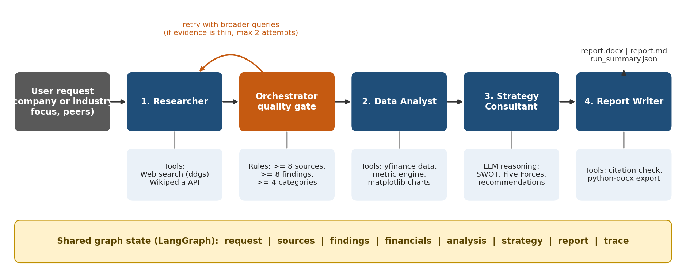
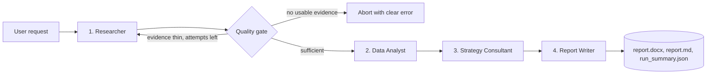

# Architecture

## Agent contracts

| Agent | Reads from state | Writes to state | Tools | Key guardrail |
|---|---|---|---|---|
| Researcher | request | sources, findings | `ddgs` web search, Wikipedia REST API | Findings must cite valid source ids, otherwise dropped |
| Quality gate (orchestrator) | sources, findings | gate_decision, limitations | none (rules) | Retries with broader queries, aborts if no evidence |
| Data Analyst | request, findings | financials, analysis | `yfinance`, metric engine, matplotlib | Insights containing numbers not in the data table are removed |
| Strategy Consultant | findings, analysis | strategy | LLM only | Invalid citation ids stripped; one repair retry if SWOT/forces/recommendations are incomplete |
| Report Writer | all of the above | report_markdown, report_paths | python-docx | Citation numbers not matching a real source are removed |

## Design decisions

1. **Deterministic where possible.** Financial metrics, tables, SWOT layout and references are produced by code, not by the LLM. The LLM writes prose and judgement only.
2. **Grounding by construction.** Every claim carries source ids; ids are validated against the real source list at three stages.
3. **Supervisor loop.** The quality gate is a plain function node, so retry behaviour is testable without any LLM.
4. **Provider independence.** One `LLMClient` wraps OpenAI-compatible APIs (OpenAI, Groq, Gemini, OpenRouter, Ollama) and Anthropic, plus an offline mock for tests.
5. **Graceful degradation.** Missing tickers, failed searches, or malformed LLM JSON reduce the output and add limitations, rather than crashing the run.
